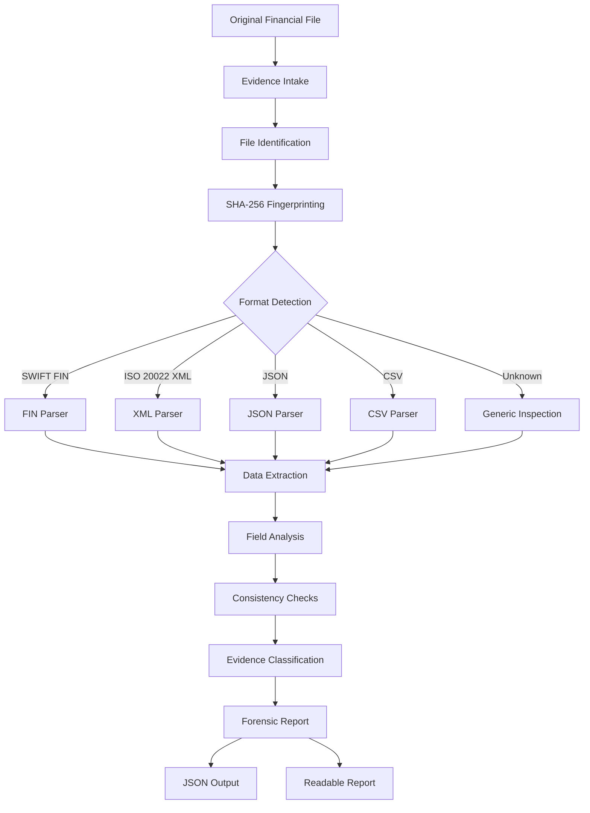
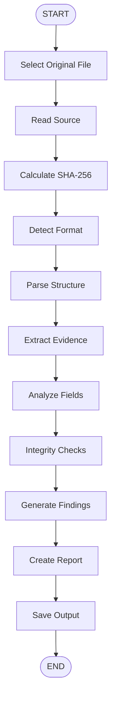

# 🏦 BANK-H2H-FORENSICS

<p align="center">

</p>

<h3 align="center">Financial File Intelligence & Transaction Evidence Analyzer</h3>

<p align="center"><b>Analyze the Evidence. Verify the Data. Never Assume the Transaction.</b></p>

<p align="center">


</p>

<p align="center">


</p>

---

## 🔎 Overview

BANK-H2H-FORENSICS is an independent financial file intelligence and forensic analysis toolkit designed to inspect real banking-related files, payment messages, transaction instructions, and financial evidence.

The project focuses on original file examination, format identification, structured data extraction, cryptographic fingerprinting, consistency analysis, and evidence-based reporting.

It analyzes source files without assuming that a document proves payment execution, settlement, or beneficiary credit.

## 🎯 Objectives

- Analyze original financial files
- Identify banking message formats
- Parse SWIFT FIN messages
- Analyze ISO 20022 XML
- Extract transaction references and identifiers
- Extract amounts, currencies, BICs, and timestamps
- Calculate SHA-256 file fingerprints
- Detect structural inconsistencies
- Generate forensic reports
- Preserve evidence integrity

## ⚡ Features

| Feature | Description |
|---|---|
| File Identification | Detect file formats |
| SWIFT FIN Analyzer | Inspect FIN message structures |
| ISO 20022 Parser | Analyze XML messages |
| JSON Analyzer | Extract structured information |
| CSV Analyzer | Analyze transaction tables |
| SHA-256 | Calculate file fingerprints |
| Metadata Extraction | Extract references and timestamps |
| Field Analysis | Identify financial data |
| Evidence Reporting | Generate forensic reports |
| Integrity Analysis | Detect structural inconsistencies |

## 🏦 Supported Format Targets

### SWIFT FIN
- MT103
- MT202
- MT202 COV
- MT199
- MT192 / MT292

### ISO 20022
- pacs.008
- pacs.009
- pacs.002
- pacs.004
- pain.001
- pain.002
- camt.053
- camt.054

### General Files
- XML
- JSON
- CSV
- TXT
- Generic text
- Unknown file formats

Actual support depends on implemented parser coverage and message structure.

---

## 🏗️ Architecture



## 🔄 Forensic Workflow



## 🛡️ Evidence Classification

| Evidence | Meaning |
|---|---|
| Original File | Source submitted for examination |
| SHA-256 | Fingerprint of analyzed contents |
| Message ID | Identifier extracted from file |
| Transaction Reference | Reference contained in source |
| BIC | Institution identifier in source |
| Amount & Currency | Financial values found in source |
| Bank Authentication | Requires independent verification |
| Payment Execution | Requires reliable external confirmation |
| Settlement | Requires settlement evidence |
| Beneficiary Credit | Requires receiving-bank evidence |

## 🔐 File Integrity

The analyzer calculates SHA-256 fingerprints of original source files to support integrity checking and file comparison.

```text
File Name          : source_file.xml
Format             : XML
SHA-256            : CALCULATED FINGERPRINT
Analysis Status     : COMPLETED
Bank Origin        : NOT VERIFIED
Execution          : NOT VERIFIED
Settlement         : NOT VERIFIED
Beneficiary Credit : NOT VERIFIED
```

SHA-256 does not independently prove bank origin, authorization, execution, settlement, or beneficiary credit.

## 📂 Project Structure

```text
BANK-H2H-FORENSICS/
├── app/
├── evidence/
│   ├── original/
│   ├── processed/
│   └── reports/
├── output/
├── tests/
├── docs/
├── README.md
├── LICENSE
├── requirements.txt
└── .gitignore
```

## 📊 Report Data Model

```json
{
  "project": "BANK-H2H-FORENSICS",
  "analysis_status": "COMPLETED",
  "file_name": "source_file.xml",
  "file_format": "XML",
  "sha256": "calculated-file-hash",
  "verification": {
    "bank_origin": "NOT_VERIFIED",
    "execution": "NOT_VERIFIED",
    "settlement": "NOT_VERIFIED",
    "beneficiary_credit": "NOT_VERIFIED"
  }
}
```

## 🧰 Technology Stack

- Python — analysis engine (planned)
- XML — structured message parsing
- JSON — structured data output
- CSV — tabular analysis
- SHA-256 — file integrity fingerprints
- Git — version control
- GitHub — project collaboration and distribution

## 🚀 Roadmap

### Phase 1 — Foundation
- [x] Repository initialization
- [x] Project directory structure
- [x] README documentation
- [ ] Python environment setup
- [ ] File intake engine
- [ ] SHA-256 module

### Phase 2 — Parsers
- [ ] SWIFT FIN parser
- [ ] ISO 20022 XML parser
- [ ] JSON parser
- [ ] CSV parser
- [ ] File detection engine

### Phase 3 — Analysis
- [ ] Field extraction
- [ ] Reference analysis
- [ ] Amount and currency extraction
- [ ] BIC identification
- [ ] Timestamp extraction
- [ ] Structural validation
- [ ] Consistency checks

### Phase 4 — Reporting
- [ ] JSON reports
- [ ] Human-readable reports
- [ ] Evidence index
- [ ] Hash manifest
- [ ] Batch analysis

## 🧪 Testing

Testing will use authorized source files, public technical specifications, clearly labeled synthetic fixtures, malformed files, parser edge cases, and integrity comparison tests.

Synthetic data is strictly for software testing and must never be represented as genuine banking evidence.

## 🔒 Security & Privacy

- Analyze only files you are authorized to access.
- Preserve original evidence files.
- Never upload confidential banking data to a public repository.
- Protect account numbers, IBANs, identities, credentials, and transaction details.
- Keep original evidence separate from processed output.

## 🤝 Contributing

Contributions, parser improvements, documentation, bug reports, and security reviews are welcome.

1. Fork the repository.
2. Create a feature branch.
3. Implement your changes.
4. Test your changes.
5. Submit a Pull Request.

## 📜 License

This project is intended to use the MIT License. See LICENSE for details.

## ⚠️ Disclaimer

BANK-H2H-FORENSICS is an independent open-source technical research project. It is not affiliated with or endorsed by SWIFT, any bank, payment network, financial institution, or regulatory authority.

This software analyzes file contents and technical structures. It does not independently prove bank authentication, payment execution, settlement, available balance, or beneficiary credit.

All analysis must be performed on files the user is authorized to access.

## ☕ Support the Project

If this project has helped your research, learning, or security operations, consider supporting its continued development.

<div align="center">

<a href="https://www.paypal.com/paypalme/bungtempong99">

</a>

</div>

---

<p align="center">
<b>Built for evidence-based financial file analysis.</b><br>
<i>Analyze the evidence. Verify the data. Never assume the transaction.</i>
</p>
