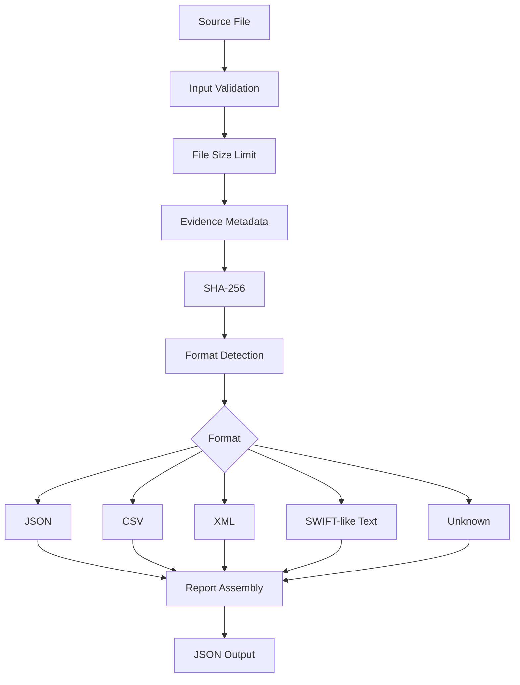

# 🏦 BANK-H2H-FORENSICS

**Financial File Intelligence & Transaction Evidence Analyzer**

> Analyze the Evidence. Verify the Data. Never Assume the Transaction.

Independent Python toolkit for financial-file inspection, structured-data parsing, evidence metadata, SHA-256 fingerprinting, and forensic reporting.

## Project Status

| Item | Value |
|---|---|
| Version | 0.3.0 |
| Python | 3.10+ |
| Status | Active Development |
| Platform | Windows / Linux |
| Maximum Input Size | 25 MB |
| Analysis | Evidence-based file inspection |

## Overview

BANK-H2H-FORENSICS inspects financial-related files and analyzes their contents without assuming that a document proves a real banking event.

The toolkit currently supports JSON, CSV, XML, and basic SWIFT-like text inspection. It records file metadata, calculates a SHA-256 fingerprint, creates initial evidence-intake metadata, and generates a structured JSON report.

It does not independently authenticate banks, verify payment execution, confirm settlement, or prove beneficiary credit.

## Objectives

- Inspect authorized financial-related files.
- Identify supported file types.
- Parse JSON, CSV, and XML data.
- Perform basic SWIFT-like text inspection.
- Record evidence metadata and analysis timestamps.
- Calculate SHA-256 fingerprints.
- Generate structured JSON reports.
- Preserve a clear distinction between source data and verified financial events.

## Implemented Features

| Feature | Status |
|---|---|
| JSON parser | Implemented |
| CSV parser | Implemented |
| XML parser | Implemented |
| SWIFT-like text inspection | Implemented |
| Extension-based format detection | Implemented |
| SHA-256 fingerprint | Implemented |
| Evidence metadata | Implemented |
| Initial intake event | Implemented |
| Case ID parameter | Implemented |
| JSON report generation | Implemented |
| CLI | Implemented |
| 25 MB input limit | Implemented |

## Supported Formats

| Extension | Detected Format | Capability |
|---|---|---|
| `.json` | JSON | Parse JSON, root type, data |
| `.csv` | CSV | Header checks, rows, columns, row count |
| `.xml` | XML | Parse structure and extract text elements |
| `.txt` | SWIFT_OR_TEXT | Basic text and tag inspection |
| `.fin` | SWIFT_OR_TEXT | Basic text and tag inspection |
| `.swift` | SWIFT_OR_TEXT | Basic text and tag inspection |
| Other | UNKNOWN | Metadata and SHA-256 only |

Format detection is currently based on file extensions, not full content-signature detection.

## SWIFT-Like Text Inspection

The current parser uses regular expressions to extract:

- FIN-like tag candidates
- Message type candidates
- Tag count
- Character count

This is basic structural text inspection only. It is not a complete SWIFT FIN validator and does not authenticate messages or confirm transactions.

## Architecture



## Forensic Workflow

1. Select an authorized source file.
2. Check that the input exists and is a regular file.
3. Enforce the 25 MB size limit.
4. Record evidence metadata.
5. Calculate the SHA-256 fingerprint.
6. Detect the format using its extension.
7. Run the relevant parser.
8. Record parser results and warnings.
9. Assemble the analysis report.
10. Optionally save the report as JSON.

## Evidence Classification

| Field | Meaning |
|---|---|
| Original File | Source submitted for examination |
| Filename | Recorded source filename |
| File Size | Size in bytes |
| SHA-256 | Fingerprint of the analyzed file |
| Report ID | Generated report identifier |
| Case ID | Optional operator-provided case reference |
| Timestamp | UTC analysis/intake timestamp |
| Message Type Candidate | Text candidate identified by parser |
| FIN Tag Candidate | Tag pattern extracted from source |
| Bank Origin | Requires independent verification |
| Authentication | Requires independent verification |
| Payment Execution | Requires reliable external confirmation |
| Settlement | Requires settlement evidence |
| Beneficiary Credit | Requires receiving-bank confirmation |
| Funds Availability | Requires independent confirmation |

## File Integrity

SHA-256 is used to generate a fingerprint for file comparison and integrity checks.

A matching hash can help establish that two files contain identical bytes. A hash alone does not prove the origin, authenticity, truth, authorization, execution, settlement, or credit status of a financial transaction.

## Chain of Custody

The current implementation records an initial evidence intake event with metadata including the report ID, optional case ID, timestamp, source filename, size, and SHA-256 fingerprint.

This is an initial intake record, not a complete chain-of-custody system. Append-only custody history, signed events, verified operator identity, immutable external storage, and a full audit trail are not currently implemented.

## Report Contents

Reports may include:

- Tool name and version
- Analysis timestamp
- Report and case identifiers
- Source filename and size
- Detected format
- SHA-256 fingerprint
- Parser output
- Warnings
- Limitations

## Example Report Structure

```json
{
  "tool": "BANK-H2H-FORENSICS",
  "version": "0.3.0",
  "analysis_timestamp_utc": "generated-at-runtime",
  "source": {
    "filename": "sample.json",
    "size_bytes": 1234,
    "detected_format": "JSON",
    "sha256": "calculated-hash"
  },
  "analysis": {
    "status": "COMPLETED",
    "parser_result": {},
    "warnings": []
  },
  "limitations": [
    "File analysis does not authenticate the source institution.",
    "A file hash does not prove the truth of file contents.",
    "Parsing does not prove payment execution or settlement.",
    "Funds availability must be independently confirmed."
  ]
}
```

## Installation

Clone the repository:

```bash
git clone https://github.com/kongali1720/BANK-H2H-FORENSICS.git
cd BANK-H2H-FORENSICS
```

Create a virtual environment:

**Linux**

```bash
python3 -m venv .venv
source .venv/bin/activate
```

**Windows PowerShell**

```powershell
python -m venv .venv
.venv\Scripts\Activate.ps1
```

**Windows Git Bash**

```bash
python -m venv .venv
source .venv/Scripts/activate
```

Install:

```bash
python -m pip install --upgrade pip
python -m pip install -e .
```

## CLI Usage

Display help:

```bash
python -m bank_h2h_forensics --help
```

Analyze a file:

```bash
python -m bank_h2h_forensics samples/sample-transactions.json
```

Save a report:

```bash
python -m bank_h2h_forensics samples/sample-transactions.json \
  --output output/sample-report.json
```

Specify a case ID:

```bash
python -m bank_h2h_forensics samples/sample-transactions.json \
  --case-id CASE-001 \
  --output output/CASE-001-report.json
```

| Argument | Description |
|---|---|
| `file` | Input JSON, CSV, XML, or SWIFT-like text file |
| `-h`, `--help` | CLI help |
| `-o`, `--output` | Optional JSON report destination |
| `--case-id` | Optional case identifier |

## Project Structure

```text
BANK-H2H-FORENSICS/
├── bank_h2h_forensics/
│   ├── __init__.py
│   ├── __main__.py
│   ├── analyzer.py
│   ├── cli.py
│   ├── detector.py
│   ├── evidence.py
│   ├── hashing.py
│   ├── reporter.py
│   ├── validation.py
│   └── parsers/
│       ├── csv_parser.py
│       ├── json_parser.py
│       ├── swift_parser.py
│       └── xml_parser.py
├── tests/
├── docs/
├── README.md
├── LICENSE
└── pyproject.toml
```

## Technology Stack

- Python
- JSON
- CSV
- XML
- Regular Expressions
- SHA-256
- Git
- GitHub Actions

## Security & Privacy

- Only analyze files you are authorized to access.
- Preserve original source files.
- Do not publish confidential banking evidence.
- Protect account numbers, IBANs, names, credentials, and transaction references.
- Use synthetic data for public examples and tests.
- Keep evidence separate from generated reports.
- Review reports before sharing.
- Never treat parser output as proof of a financial transaction.

## Testing

Testing should cover:

- Valid JSON, CSV, and XML
- Malformed and invalid input
- SWIFT-like text patterns
- Parser edge cases
- SHA-256 consistency
- File-size limits
- Report generation
- Synthetic fixtures

Synthetic data must never be represented as genuine banking evidence.

## Roadmap

### Foundation

- [x] Package and CLI foundation
- [x] JSON, CSV, XML inspection
- [x] SWIFT-like text inspection
- [x] SHA-256 fingerprinting
- [x] Evidence intake metadata
- [x] Initial intake event
- [x] JSON report output
- [x] CI quality gates

### Parser Improvements

- [ ] Content-based file detection
- [ ] Expanded SWIFT FIN structural analysis
- [ ] More detailed ISO 20022 message inspection
- [ ] Expanded field extraction
- [ ] Additional parser edge-case tests

### Analysis & Reporting

- [ ] Expanded reference analysis
- [ ] Amount and currency extraction
- [ ] Institution identifier analysis
- [ ] Timestamp normalization
- [ ] Structural consistency checks
- [ ] Evidence manifest
- [ ] Batch analysis
- [ ] Enhanced human-readable reports

### Evidence Handling

- [ ] Expanded custody event model
- [ ] Operator event metadata
- [ ] Signed evidence manifests
- [ ] Reproducibility improvements
- [ ] Optional immutable audit storage

Roadmap items are not current capabilities.

## Contributing

1. Fork the repository.
2. Create a feature branch.
3. Implement changes.
4. Add or update tests.
5. Run tests and lint checks.
6. Submit a Pull Request.

Do not submit real confidential banking data in issues, pull requests, or fixtures.

## License

See `LICENSE` for the applicable license.

## Disclaimer

BANK-H2H-FORENSICS is an independent open-source technical research project. It is not affiliated with or endorsed by SWIFT, any bank, payment network, financial institution, or regulatory authority.

This software analyzes file contents and technical structures. It does not independently prove bank origin, message authentication, payment authorization, payment execution, settlement, beneficiary credit, or funds availability.

Financial claims must be independently verified through trusted official channels. All analysis must be performed on files the operator is authorized to access.

## Support the Project

If this project supports your research or development, consider supporting continued development.

[Support Development via PayPal](https://www.paypal.com/paypalme/bungtempong99)

---

<p align="center">
<b>Built for evidence-based financial file analysis.</b><br>
<i>Analyze the evidence. Verify the data. Never assume the transaction.</i>
</p>
