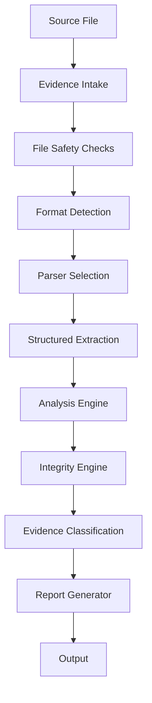

# System Architecture

## Purpose

BANK-H2H-FORENSICS is designed as a modular financial-file examination toolkit.

The architecture separates intake, identification, parsing, analysis, integrity processing, and report generation.

## Core Pipeline



## Components

### Evidence Intake

Responsible for receiving user-selected files and establishing an examination record.

Intake should not silently modify original files.

### File Safety Checks

Responsible for:

- File size limits
- Input path validation
- File extension inspection
- Basic content-type identification
- Safe temporary handling
- Rejecting unsafe paths
- Protecting against unexpected content

File extensions are not considered authoritative format indicators.

### Format Detection

Determines which parser may be appropriate.

Detection should use file content and structural clues when possible, rather than relying only on file extensions.

### Parser Layer

Parser modules are isolated by format.

Planned modules:

- SWIFT FIN
- ISO 20022 XML
- JSON
- CSV
- Plain text

A parser extracts fields and structural information. It does not authenticate a document's origin.

### Analysis Engine

The analysis layer evaluates extracted information.

Examples:

- Missing required fields
- Duplicate identifiers
- Inconsistent amounts
- Unexpected field patterns
- Format inconsistencies
- Date and timestamp observations
- Reference correlation

Each finding should identify the evidence and rule that produced it.

### Integrity Engine

The integrity engine calculates file fingerprints and may compare source files.

Planned algorithms:

- SHA-256

The integrity result should be recorded separately from authentication claims.

### Evidence Classification

Findings should distinguish:

- Observed
- Extracted
- Calculated
- Inferred
- Unverified
- Independently verified

The system must not blur these categories.

### Report Generator

The report generator produces structured output and readable summaries.

Reports should include:

- File name
- File size
- File hash
- Detection result
- Parser result
- Extracted fields
- Findings
- Limitations
- Analysis timestamp
- Tool version when available

## Data Flow

The original file remains separate from processed data and reports.

```text
evidence/original/
    Original source files

evidence/processed/
    Parsed and normalized analysis artifacts

evidence/reports/
    Human-readable forensic reports

output/
    Temporary or exportable analysis results
```

## Design Principles

- Modular
- Evidence-oriented
- Reproducible
- Secure-by-default
- Privacy-preserving
- Explicit about limitations
- Non-destructive
- Offline-capable where practical
- No unsupported authenticity claims

## Future Architecture

Future capabilities may include a CLI, batch processing, structured report exports, schema validation, and an optional graphical interface.

These capabilities must not compromise evidence preservation or security.
